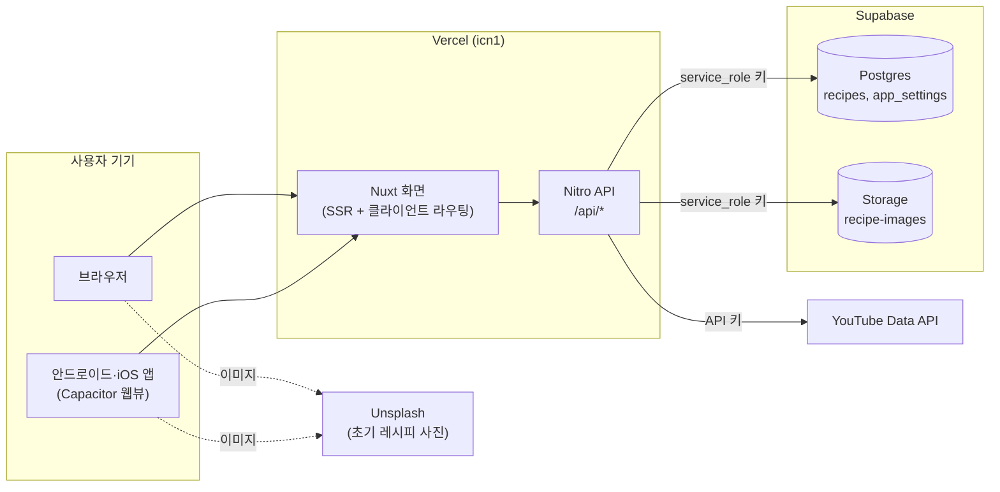
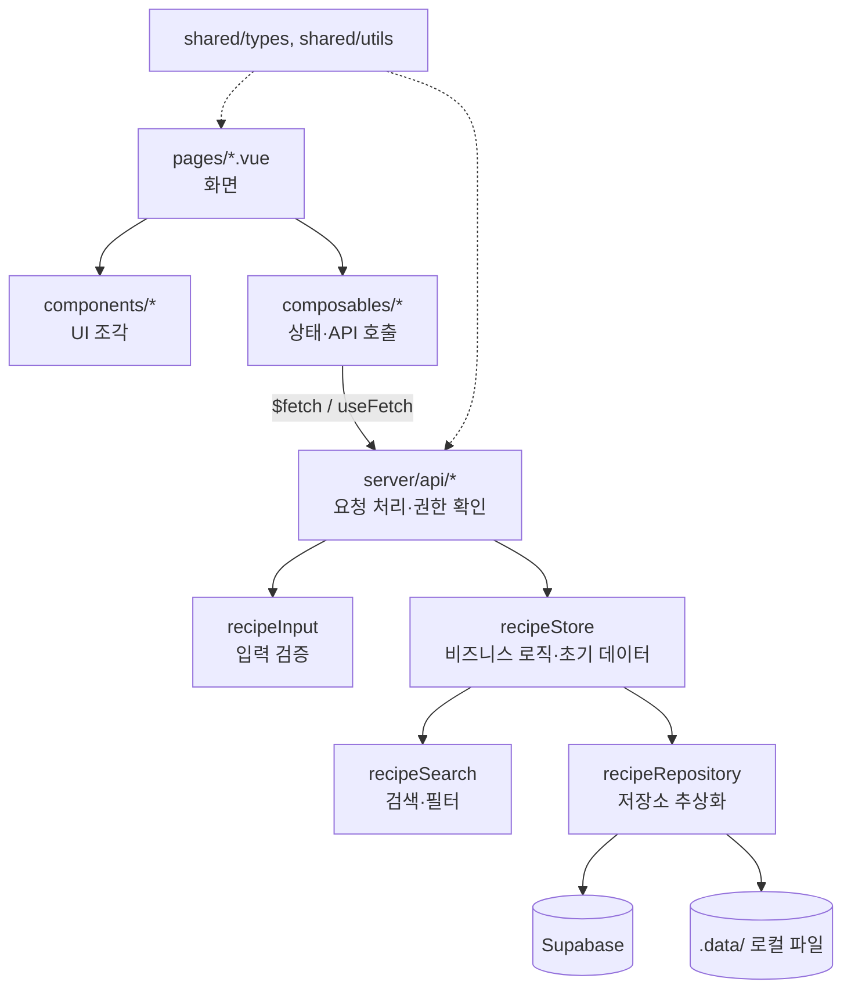
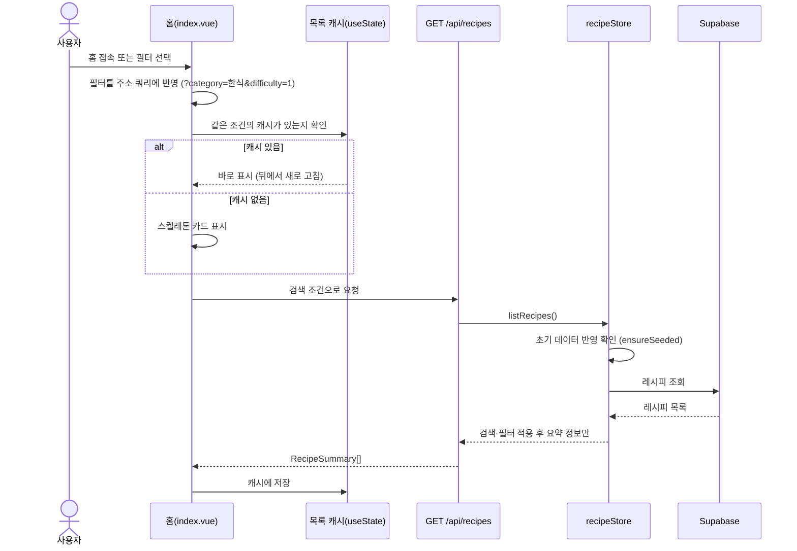
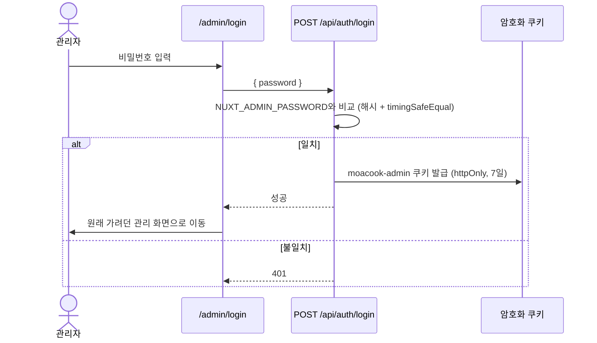
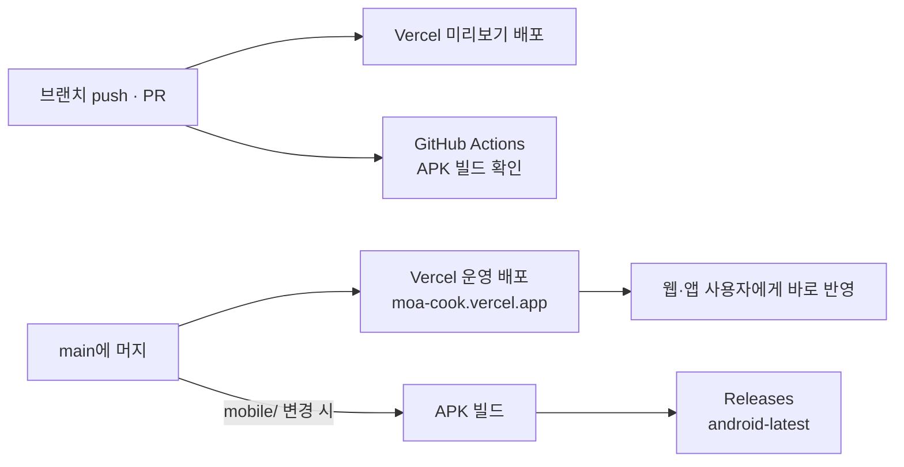

# MoaCook

여러 요리의 레시피를 한곳에 모아 두고, 누구나 쉽게 찾아서 따라 할 수 있게 만든 요리 레시피 서비스입니다.

- 웹: https://moa-cook.vercel.app
- 안드로이드 앱: GitHub Releases의 `android-latest`에서 APK 설치
- 아이폰: Safari에서 **홈 화면에 추가** (자세한 방법은 [docs/DEPLOY.md](docs/DEPLOY.md))

## 개발 목적

- **레시피를 한곳에서**: 블로그·영상·메모에 흩어진 레시피를 같은 형식(재료, 분량, 조리 순서)으로 정리해 한 화면에서 봅니다.
- **오늘 할 요리를 빠르게 고르기**: 검색어, 카테고리, 난이도, 조리 시간으로 걸러서 지금 상황에 맞는 요리를 바로 찾습니다.
- **글로 부족한 부분은 영상으로**: 상세 화면에서 같은 요리의 유튜브 영상을 함께 보여 줍니다.
- **관리자가 직접 운영**: 별도 CMS 없이 관리자 화면에서 레시피를 등록·수정·삭제하고 사진을 올립니다.
- **웹과 앱을 하나의 코드로**: 같은 웹 서비스를 안드로이드·아이폰 앱으로도 감싸서, 한 번 배포하면 모든 기기에 반영됩니다.

## 주요 기능

| 구분 | 기능 |
|---|---|
| 목록(홈) | 레시피 카드 목록, 검색(이름·설명·재료, 띄어쓰기 무시), 카테고리(한식·중식·일식·양식·비건)·난이도·조리 시간 필터 |
| 상세 | 대표 사진, 재료와 분량, 단계별 조리 과정(단계 사진 선택), 유튜브 참고 영상 |
| 사용성 | 필터와 스크롤 위치를 기억해 상세에서 돌아와도 그대로 유지, 로딩 중 스켈레톤 표시 |
| 관리자 | 비밀번호 로그인, 레시피 등록·수정·삭제, 사진 업로드 |
| 앱 | 안드로이드 APK(뒤로가기 버튼 지원), 아이폰 홈 화면 앱(PWA) |

## 기술 스택

| 영역 | 사용 기술 | 쓰는 곳 |
|---|---|---|
| 프레임워크 | [Nuxt 4](https://nuxt.com) (Vue 3, Vue Router) | 화면(SSR)과 API 서버를 한 프로젝트에서 처리 |
| 언어 | TypeScript | 화면·서버·공용 타입 모두 (`any` 사용 안 함) |
| 스타일 | SCSS (scoped) | 공통 변수는 `app/assets/scss/_variables.scss` |
| 글꼴 | Pretendard | `public/fonts`에 포함 |
| 서버 | Nitro (Nuxt 내장) | `server/api`의 REST API |
| 데이터베이스 | Supabase Postgres | `recipes` 테이블 (REST로 접근) |
| 파일 저장 | Supabase Storage | 업로드 사진 (`recipe-images` 버킷) |
| 외부 API | YouTube Data API v3 | 참고 영상 검색 (서버에서만 호출) |
| 배포 | Vercel | 서울 리전(`icn1`) 서버리스 함수 |
| 모바일 앱 | Capacitor 8 | 배포된 웹을 감싸는 안드로이드·iOS 앱 |
| CI | GitHub Actions | 안드로이드 APK 빌드와 릴리스 업로드 |
| 패키지 관리 | pnpm | |
| 코드 품질 | ESLint (`@nuxt/eslint`), vue-tsc | `pnpm lint`, `pnpm typecheck` |

추가 런타임 라이브러리 없이 Nuxt와 Vue만 사용합니다. Supabase도 SDK 없이 Nuxt의 `$fetch`로 REST API를 호출합니다.

## 시스템 구성



- 모든 키(Supabase service_role, YouTube API 키, 관리자 비밀번호)는 서버 환경변수에만 있고 브라우저로 내려가지 않습니다.
- 앱은 웹을 그대로 띄우는 구조라서 Vercel에 배포하면 앱도 바로 최신 화면이 됩니다. 앱을 다시 설치해야 하는 경우는 아이콘이나 네이티브 설정이 바뀔 때뿐입니다.

## 프로젝트 구조

```text
MoaCook/
├── app/                          # 화면 (Nuxt 앱)
│   ├── app.vue                   # 루트: 로딩 표시줄, 안전 영역 변수, 스켈레톤 공통 스타일
│   ├── layouts/default.vue       # 헤더 + 본문 + 푸터
│   ├── pages/
│   │   ├── index.vue             # 홈 = 레시피 목록, 검색·필터
│   │   ├── recipes/
│   │   │   ├── index.vue         # 예전 주소(/recipes) → 홈으로 이동
│   │   │   └── [id].vue          # 레시피 상세
│   │   └── admin/
│   │       ├── login.vue         # 관리자 로그인
│   │       ├── index.vue         # /admin → /admin/recipes 이동
│   │       └── recipes/
│   │           ├── index.vue     # 레시피 관리 목록 (수정·삭제)
│   │           ├── new.vue       # 레시피 등록
│   │           └── [id]/edit.vue # 레시피 수정
│   ├── components/
│   │   ├── layout/               # HeaderComp(로고·검색), FooterComp
│   │   ├── recipe/               # RecipeCard, RecipeCardSkeleton, RecipeForm,
│   │   │                         # RecipeYoutube, DifficultyBadge
│   │   └── common/               # AppLogo, ConfirmDialog, SelectDropdown
│   ├── composables/
│   │   ├── useRecipes.ts         # 레시피 API 호출(등록·수정·삭제·업로드)
│   │   ├── useRecipeList.ts      # 목록 캐시, 마지막 목록 주소 기억
│   │   └── useAdmin.ts           # 관리자 로그인 상태
│   ├── middleware/admin.ts       # 관리 화면 접근 제한
│   ├── utils/apiError.ts         # API 오류 메시지 변환
│   └── assets/scss/              # _variables.scss(색·간격·글자), _admin.scss
├── server/                       # API 서버 (Nitro)
│   ├── api/
│   │   ├── recipes/              # 목록·상세·등록·수정·삭제
│   │   ├── uploads/              # 이미지 업로드
│   │   ├── auth/                 # 로그인·로그아웃·상태
│   │   └── youtube/search.get.ts # 참고 영상 검색
│   ├── routes/uploads/[name].get.ts # 로컬 저장소일 때 업로드 이미지 제공
│   ├── data/recipes.ts           # 초기 레시피 104종 (SEED_VERSION)
│   └── utils/
│       ├── recipeStore.ts        # 레시피 비즈니스 로직 + 초기 데이터 반영
│       ├── recipeRepository.ts   # 저장소 추상화 (Supabase / 로컬 파일)
│       ├── recipeSearch.ts       # 검색·필터
│       ├── recipeInput.ts        # 등록·수정 요청 검증
│       ├── imageUpload.ts        # 이미지 형식·크기 검사, 저장
│       ├── adminSession.ts       # 암호화 쿠키 세션, 비밀번호 비교
│       ├── supabase.ts           # Supabase 설정·헤더·오류 처리
│       └── youtube.ts            # YouTube 검색 + 조회수 정렬 + 캐시
├── shared/                       # 화면과 서버가 함께 쓰는 코드
│   ├── types/                    # Recipe, RecipeSummary, 카테고리 등 타입
│   └── utils/recipe.ts           # 카테고리·난이도 검사, 검색 조건 변환
├── public/                       # 파비콘, 앱 아이콘, manifest, 글꼴
├── supabase/schema.sql           # 테이블·제약 조건·버킷 생성 SQL
├── mobile/                       # Capacitor 앱
│   ├── capacitor.config.ts       # 앱이 띄울 주소, 상태바 설정
│   ├── android/                  # 안드로이드 프로젝트 (뒤로가기 처리 포함)
│   └── ios/                      # iOS 프로젝트
├── .github/workflows/android.yml # APK 빌드·릴리스
├── docs/DEPLOY.md                # 배포·앱 설치 안내
└── nuxt.config.ts                # 메타 태그, 런타임 설정, Vercel 리전
```

### 계층 구조



- **저장소 추상화**: `recipeRepository()`가 Supabase 환경변수 유무에 따라 Supabase 저장소나 로컬 파일 저장소(`.data/`)를 돌려줍니다. 그래서 로컬에서는 DB 없이 바로 개발할 수 있습니다.
- **공용 타입**: `shared/`의 타입과 검사 함수를 화면과 서버가 함께 써서, 카테고리 같은 값을 한 곳만 고치면 됩니다.

## 데이터 모델

`recipes` 테이블 (자세한 내용은 [supabase/schema.sql](supabase/schema.sql))

| 컬럼 | 타입 | 설명 |
|---|---|---|
| `id` | text | 레시피 id (초기 레시피는 `kimchi-jjigae` 같은 영문, 새 레시피는 UUID) |
| `name` | text | 요리 이름 |
| `image` | text | 대표 사진 주소 |
| `description` | text | 한 줄 소개 |
| `category` | text | 한식·중식·일식·양식·비건 중 하나 (CHECK 제약) |
| `difficulty` | smallint | 1 쉬움, 2 보통, 3 어려움 |
| `cooking_time` | integer | 조리 시간(분) |
| `ingredients` | jsonb | `[{ id, name, amount }]` |
| `steps` | jsonb | `[{ id, order, description, image? }]` |
| `youtube_query` | text | 참고 영상 검색어 (없으면 요리 이름) |
| `created_at`, `updated_at` | timestamptz | 등록·수정 시각 |

`app_settings` 테이블에는 초기 데이터 버전(`seed_version`)을 저장합니다.

## 주요 흐름

### 1. 레시피 목록 보기와 검색



- 검색어와 필터는 주소 쿼리에 들어가므로, 새로 고침하거나 링크를 공유해도 같은 결과가 나옵니다.
- 목록 응답에는 재료·조리 과정을 빼고 카드에 필요한 요약 정보만 담아 가볍게 유지합니다.

### 2. 상세 보기와 돌아오기

1. 카드를 누르면 목록 캐시에 있던 요약 정보(이름, 사진, 소개)로 상세 화면 윗부분을 바로 그립니다.
2. `GET /api/recipes/:id`로 재료와 조리 과정을 받아 오는 동안 그 부분은 스켈레톤으로 보여 줍니다.
3. 유튜브 영역은 `GET /api/youtube/search`로 따로 불러옵니다. 서버가 관련도 순으로 10개를 찾은 뒤 조회수 순으로 6개를 고르고, 결과를 6시간 동안 캐시합니다. API 키가 없으면 유튜브 검색 링크만 보여 줍니다.
4. **레시피 목록** 링크나 기기 뒤로가기로 돌아오면 브라우저 기록을 따라가므로 보던 필터와 스크롤 위치가 그대로 남아 있습니다. 상세 주소로 바로 들어온 경우에는 마지막으로 보던 목록 주소로 보냅니다.

### 3. 관리자 로그인



- 관리 화면은 `middleware/admin.ts`가 `/api/auth/me`로 상태를 확인하고, 로그인하지 않았으면 로그인 화면으로 보냅니다.
- 등록·수정·삭제·업로드 API도 서버에서 세션을 다시 확인하고, 로그인하지 않았으면 401을 돌려줍니다.

### 4. 레시피 등록·수정

1. 관리자가 `RecipeForm`에 이름, 카테고리, 난이도, 조리 시간, 재료, 조리 과정을 입력합니다.
2. 사진을 고르면 `POST /api/uploads`로 먼저 올리고(jpg·png·webp·gif, 4MB 이하) 돌려받은 주소를 폼에 넣습니다.
3. 저장하면 `POST /api/recipes` 또는 `PUT /api/recipes/:id`로 보냅니다.
4. 서버의 `recipeInput`이 필수 값, 카테고리, 난이도, 길이 제한을 검사하고, 재료·단계에 id와 순서를 매깁니다.
5. `recipeStore`가 저장소에 저장하고, 화면은 상세 페이지로 이동합니다.

### 5. 초기 레시피 반영 (시딩)

1. 서버가 레시피를 처음 읽을 때 `ensureSeeded()`가 `app_settings`의 `seed_version`과 코드의 `SEED_VERSION`을 비교합니다.
2. 코드 버전이 더 높으면 `server/data/recipes.ts`에서 새로 추가된 레시피(`since`가 저장된 버전보다 큰 것)만 넣습니다.
3. 이미 있는 레시피는 관리자가 고친 내용을 지키기 위해 덮어쓰지 않습니다. 예전 저해상도 이미지나 없어진 카테고리처럼 정해진 경우만 고칩니다.
4. 하나라도 실패하면 버전을 올리지 않아서 다음에 다시 시도합니다.

### 6. 배포와 앱 빌드



- 웹 화면과 API 변경은 Vercel 배포만으로 웹과 앱 모두에 반영됩니다.
- `mobile/` 폴더가 바뀌면 GitHub Actions가 새 APK를 만들어 `android-latest` 릴리스에 올립니다. 서명 키 시크릿이 없으면 디버그 키로 서명합니다.

## 화면 설계

- **색상**: 메인 색 토마토 레드 `#F2542D`, 글자 `#16181D`, 선 `#E4E6EB`. 모든 값은 `_variables.scss`에 모아 두었습니다.
- **선 굵기**: 1.5px로 통일해 화면이 흐리지 않게 했습니다.
- **반응형**: 최대 폭 1200px. 카드는 화면 폭에 맞춰 열 수가 자동으로 바뀌고, 모바일에서는 2열입니다.
- **로딩**: 화면을 옮길 때는 위쪽 로딩 표시줄을, 데이터를 기다릴 때는 스켈레톤을 보여 줘서 멈춘 것처럼 보이지 않게 했습니다.
- **앱 안전 영역**: 상태바와 하단 네비게이션바 영역(`--safe-top`, `--safe-bottom`)만큼 여백을 둬서 내용이 겹치지 않습니다.

## 실행 방법

```bash
pnpm install   # 의존성 설치
pnpm dev       # 개발 서버 (http://localhost:3000)
pnpm build     # 프로덕션 빌드
pnpm preview   # 빌드 결과 미리보기
pnpm lint      # ESLint 검사
pnpm typecheck # 타입 검사
```

환경변수 없이 `pnpm dev`만 실행해도 로컬 파일 저장소(`.data/`)와 초기 레시피로 바로 사용할 수 있습니다.

## 환경변수

`.env.example`을 복사해 `.env`를 만들고 값을 채웁니다.

| 이름 | 설명 |
|---|---|
| `NUXT_YOUTUBE_API_KEY` | YouTube Data API v3 키. 서버에서만 사용되며, 없으면 상세 페이지에 유튜브 검색 링크만 표시됩니다. |
| `NUXT_ADMIN_PASSWORD` | 관리자 로그인 비밀번호. 없으면 레시피 등록·수정·삭제를 할 수 없습니다. |
| `NUXT_SESSION_SECRET` | 로그인 쿠키 암호화 키 (32자 이상) |
| `NUXT_SUPABASE_URL` | Supabase Project URL. 비워 두면 로컬 `.data/` 폴더에 저장합니다. |
| `NUXT_SUPABASE_SERVICE_ROLE_KEY` | Supabase secret(service_role) 키. 서버에서만 사용합니다. |
| `NUXT_SUPABASE_BUCKET` | 사진 버킷 이름 (기본 `recipe-images`) |

## 관리자

- 화면 맨 아래 **관리자** 링크(`/admin/login`)에서 `NUXT_ADMIN_PASSWORD`로 로그인합니다.
- 로그인하면 홈에 `+ 레시피 등록`, 상세 화면에 `수정하기`, 맨 아래에 `레시피 관리`(목록에서 수정·삭제)가 나타납니다.
- 등록·수정·삭제·이미지 업로드 API는 로그인하지 않으면 401을 돌려줍니다.

## 데이터 저장

- Supabase 환경변수가 있으면 레시피는 `recipes` 테이블에, 업로드 이미지는 `recipe-images` 버킷에 저장됩니다.
- 없으면 서버의 `.data/` 폴더에 파일로 저장됩니다. (`.data/recipes`, `.data/uploads`, git 제외)
- 저장소가 처음 사용될 때 초기 레시피 104종(`server/data/recipes.ts`)이 자동으로 등록됩니다. 처음 상태로 되돌리려면 서버를 멈추고 `.data/` 폴더를 지웁니다.
- 초기 레시피를 추가할 때는 `SEED_VERSION`을 올리고 새 레시피의 `since`에 같은 값을 적습니다. 이미 사용 중인 저장소에는 새 레시피만 추가되고, 사용자가 수정하거나 삭제한 레시피는 그대로 유지됩니다.
- 카테고리를 바꿀 때는 `shared/types/recipe.ts`와 `supabase/schema.sql`을 함께 고치고, Supabase에서 schema.sql을 다시 실행합니다.
- 초기 레시피 사진은 [Unsplash](https://unsplash.com/license) 무료 이미지를 원본 주소로 불러옵니다(인터넷 연결 필요).

## API

| 메서드 | 경로 | 설명 |
|---|---|---|
| GET | `/api/recipes?q=떡&category=한식&difficulty=1&maxTime=30` | 레시피 목록 (검색어·카테고리·난이도·최대 조리시간 모두 선택) |
| GET | `/api/recipes/:id` | 레시피 상세 |
| POST | `/api/recipes` | 레시피 등록 (관리자) |
| PUT | `/api/recipes/:id` | 레시피 수정 (관리자) |
| DELETE | `/api/recipes/:id` | 레시피 삭제 (관리자) |
| POST | `/api/uploads` | 이미지 업로드 (관리자, multipart, 필드 `image`, 4MB 이하) |
| GET | `/api/auth/me` | 관리자 로그인 여부 |
| POST | `/api/auth/login` | 관리자 로그인 (`{ password }`) |
| POST | `/api/auth/logout` | 관리자 로그아웃 |
| GET | `/api/youtube/search?q=김치찌개` | 유튜브 참고 영상 검색 (6시간 캐시) |

## 개발 규칙

- Vue 파일은 `template` → `script setup lang="ts"` → `style lang="scss" scoped` 순서로 씁니다.
- `any`를 쓰지 않고 타입을 명시합니다.
- 브랜치 이름은 한 단어, 커밋 메시지는 `feat:` / `fix:` / `chore:` 뒤에 한국어로 씁니다.
- API 키 같은 비밀 값은 서버 환경변수에만 두고 저장소에 올리지 않습니다.

## 배포

Vercel·Supabase 설정, 안드로이드 APK 설치, 아이폰 사용 방법은 [docs/DEPLOY.md](docs/DEPLOY.md)를 참고합니다.
